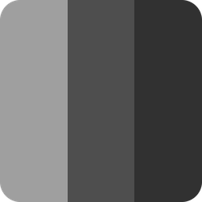

<!-- markdownlint-disable MD013 MD033 MD041 -->

# Presenter — Landing Page

Página de apresentação (landing page) do **[Presenter](https://github.com/silv4b/presenter)**, um app desktop de apresentação de PDFs. Esta página é uma vitrine estática que resume os recursos do aplicativo, seus atalhos, formas de instalação e perguntas frequentes.

> Construída com **React 19 + TypeScript + Vite + Tailwind CSS 4**, com tema escuro/claro alternável, design responsivo e conteúdo centralizado em um único arquivo de dados.

<p>
  
</p>

---

## Sobre

O [Presenter](https://github.com/silv4b/presenter) é um aplicativo de apresentação de PDFs para desktop (Tauri 2 + React + TypeScript): transforma um arquivo PDF em uma apresentação estilo PowerPoint, com janela de controle para o apresentador e projeção em tela cheia para o público.

**Este repositório** contém apenas a **landing page** que divulga esse app — não é o aplicativo em si.

## Stack

| Camada | Tecnologia |
| --- | --- |
| UI | [React 19](https://react.dev/) |
| Linguagem | [TypeScript](https://www.typescriptlang.org/) |
| Build / Dev server | [Vite 7](https://vite.dev/) |
| Estilos | [Tailwind CSS 4](https://tailwindcss.com/) (`@tailwindcss/vite`) |
| Ícones | [Lucide](https://lucide.dev/) (`lucide-react`) |

Sem bibliotecas de UI adicionais — todos os componentes (mock de janela, carrossel, lightbox, acordeão) são feitos à mão com CSS/Tailwind.

## Começando

### Pré-requisitos

- **Node.js 20.19+ ou 22.12+** (exigência do Vite 7) e npm.

### Instalação

```sh
npm install
```

### Scripts

| Comando | Descrição |
| --- | --- |
| `npm run dev` | Inicia o servidor de desenvolvimento (padrão: http://localhost:5173) |
| `npm run build` | Checagem de tipos (`tsc -b`) + build de produção em `dist/` |
| `npm run preview` | Serve localmente o build de produção |
| `npm run lint` | Apenas a checagem de tipos (`tsc -b --noEmit`) |

Fluxo típico de desenvolvimento:

```sh
npm run dev      # desenvolve com HMR
npm run build    # gera dist/
npm run preview  # confere o build
```

## Estrutura do projeto

```
presenter-page/
├── public/
│   ├── presenter-logo.png        # logo do app (favicon + navbar/footer)
│   ├── presenter.svg             # ícone vetorial alternativo
│   └── screenshots/              # prints reais do Presenter (seção Galeria + Hero)
├── src/
│   ├── components/               # componentes de UI da página
│   ├── data/
│   │   └── content.ts            # TODO o conteúdo textual, tipado (fonte única)
│   ├── lib/
│   │   ├── theme.ts              # store do tema claro/escuro (localStorage)
│   │   └── useReveal.ts          # animação de entrada por IntersectionObserver
│   ├── App.tsx                   # composição das seções
│   ├── index.css                 # Tailwind + tokens de tema + utilitários
│   ├── main.tsx                  # bootstrap do React
│   └── vite-env.d.ts
├── index.html                    # head, favicon, fontes e script anti-FOUC do tema
├── vite.config.ts                # plugins + watcher (ignora arquivos temporários)
├── tsconfig*.json
└── package.json
```

## Seções da página

Na ordem em que aparecem em `src/App.tsx`:

1. **AnnouncementBar** — faixa dispensável no topo com link para os releases.
2. **Navbar** — navegação fixa (sticky), alternador de tema e menu mobile.
3. **Hero** — chamada principal, CTAs e print real da janela de controle (com fallback para um *mock* interativo).
4. **Marquee** — faixa animada com destaques.
5. **Features** — grade de recursos (multi-monitor, cronômetro, etc.).
6. **Gallery** — visualizador de prints em 2 colunas + miniaturas + *lightbox* navegável.
7. **AnnotationTools** — caneta, marcador, laser e borracha, com atalhos.
8. **Shortcuts** — tabela de teclas de atalho.
9. **Usage** — passo a passo de uso.
10. **Downloads** — abas por plataforma + comandos de instalação de uma linha.
11. **FAQ** — perguntas frequentes em acordeão.
12. **Support** — formas de apoiar o projeto.
13. **Footer** — navegação, GitHub e créditos.

## Conteúdo

Todo o texto (recursos, atalhos, FAQ, plataformas, links, marquee) vive em **`src/data/content.ts`**, tipado e exportado em constantes. Para editar textos, listas ou links, altere esse arquivo — os componentes apenas consomem os dados.

## Tema claro / escuro

- **Botão sol/lua** no navbar (desktop e menu mobile) alterna os temas.
- A escolha é **persistida em `localStorage`** (chave `presenter-theme`) e aplicada **antes do primeiro paint** por um script inline em `index.html` (evita "flash" de tema).
- O **tema escuro é o padrão**.
- A implementação é baseada em **tokens**: as cores são variáveis CSS (`--color-*`) definidas em `src/index.css`. O tema claro apenas **sobrescreve essas variáveis** em `[data-theme="light"]`, invertendo toda a UI (fundos, textos, bordas, gradientes e opacidades) sem espalhar classes `dark:` pelos componentes.
- O store fica em `src/lib/theme.ts` (via `useSyncExternalStore`), então todos os botões de tema ficam sincronizados.

## Imagens e screenshots

Os prints reais usados na Hero e na Galeria ficam em **`public/screenshots/`**. Para trocá-los, veja `public/screenshots/README.md` ou ajuste os caminhos em `src/data/content.ts`:

- `HERO_SHOT` — imagem usada no Hero.
- `screenshots` — lista `{ src, title, caption, tag }` da Galeria.

As imagens que não carregarem são **ocultadas automaticamente** (a Galeria mostra um estado vazio amigável e o Hero cai para o mock).

## Responsividade e acessibilidade

- Layout mobile-first; navegação desktop entra em `lg` e vira menu hambúrguer abaixo disso.
- Grids usam `minmax(0, …)` + `min-w-0` para evitar estouro horizontal.
- Imagens com `alt`, botões com `aria-label`, foco visível e contraste adequado em ambos os temas.
- Respeita `prefers-reduced-motion` (animações desativadas).

## Build de produção

```sh
npm run build
```

Gera os arquivos estáticos em **`dist/`** (prontos para qualquer host estático: GitHub Pages, Netlify, Vercel, etc.). Para conferir localmente:

```sh
npm run preview
```

## Créditos

- **Presenter** (aplicativo): [github.com/silv4b/presenter](https://github.com/silv4b/presenter)
- Inspiração de layout/estrutura visual: [getplexo.app](https://getplexo.app/)

## Licença

Este projeto é a landing page de divulgação do Presenter. Consulte o repositório do aplicativo para os termos de licença.
